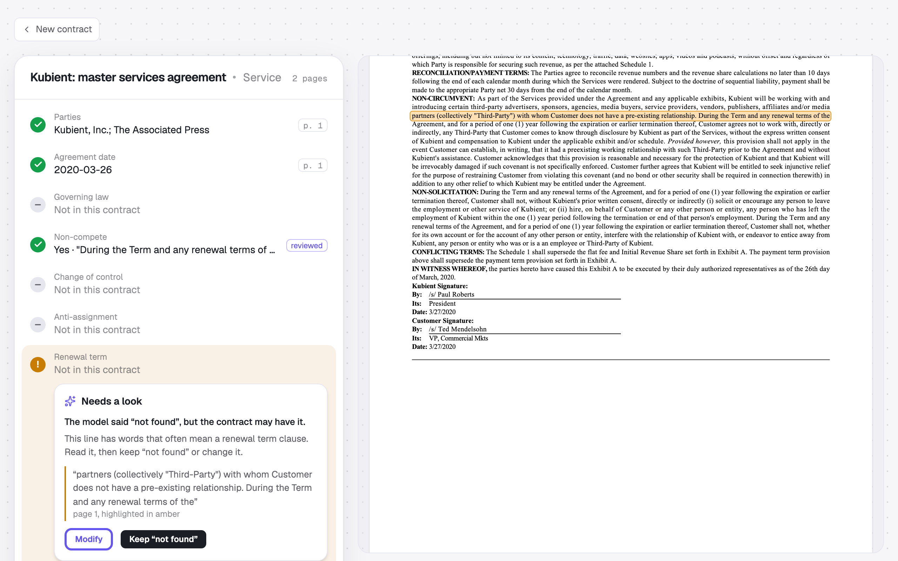
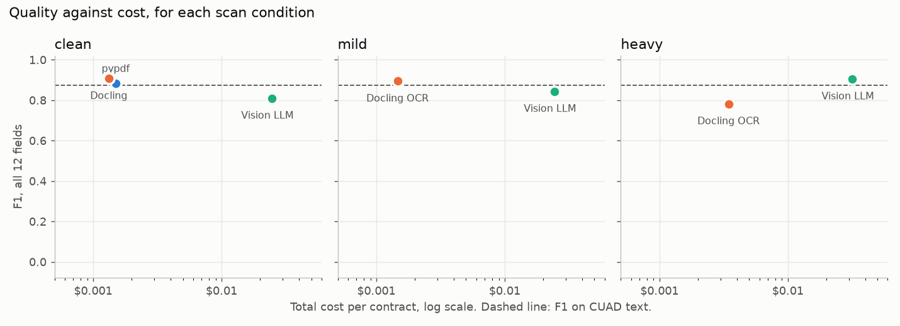
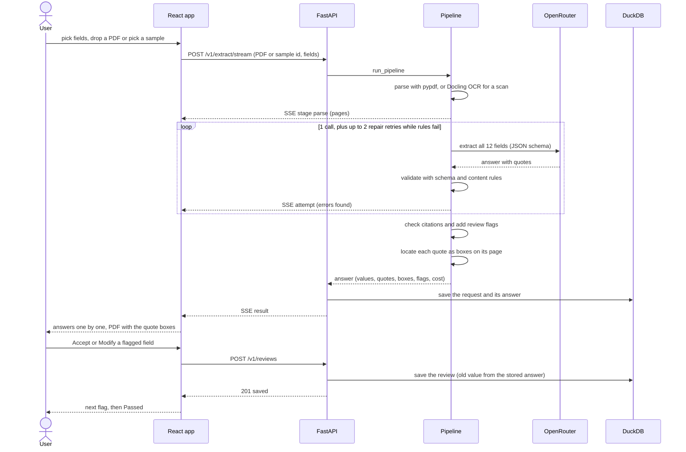

# doc-intell-pipeline

Contract PDFs in, cited and validated JSON out. Every answer comes with the exact quote from the contract, a box
around that quote in the PDF, and a needs-review flag that a person can accept or fix.



Built on [CUAD](https://www.atticusprojectai.org/cuad) (510 contracts labelled by lawyers), and measured with
precision, recall and F1 per field. The project idea comes from Aishwarya Reganti (see [Acknowledgements](#acknowledgements)).

## Features

- **12 contract fields** in 4 groups: parties, dates, governing law, yes or no clauses (non-compete, change of
  control, anti-assignment), renewal and liability terms, license and IP.
- **Cited answers.** Each answer quotes the contract. A citation check confirms the quote is really in the text.
- **Trust layer.** Schema and content rules, review flags (for example "the model said not found, but this line
  mentions renewal"), and repair retries that send the errors back to the model.
- **Three parsers:** pypdf, Docling (with OCR for scans) and a vision LLM, compared on clean PDFs and fake scans.
- **Review app.** Pick fields, drop a PDF or pick a sample, watch the live stages, click an answer to see its quote in
  the PDF, then Accept or Modify each flag. Copy the reviewed answer as JSON.
- **Measured.** An eval runner with a `run_id` for every run, cost and latency per call, and local traces in Phoenix.

## Results

All numbers are on the dev split (52 contracts, 12 fields). The test split is kept for final numbers.

| What | Result |
|---|---|
| Extraction, DeepSeek V4 Flash, prompt v1 | F1 **0.912** (P 0.890, R 0.935), about $0.004 per contract |
| Baseline, Qwen3-235B, same rules | F1 0.827 (gap +0.085, 95% range +0.053 to +0.118) |
| Validation on stored answers | errors on 0.5% of fields, 5.6% flagged for review, 0 made-up quotes |
| Repair retries (max 2) | 1 field fixed, 0 lost, +7% cost: kept |
| Blank fields that fail a rule | lost right answers: not kept |
| Weakest fields | non-compete (0.67), change of control (0.70), notice to stop renewal (0.70) |

Parsers, on 9 dev contracts (69 pages), each through the same pipeline (cost is per contract, parse plus extract):

| Input | Best choice | Docling F1 | Vision LLM F1 | Docling cost | Vision LLM cost |
|---|---|---|---|---|---|
| PDF with a text layer | Docling (no OCR) | 0.91 | 0.81 | $0.0013 | $0.025 |
| Mild scan | Docling OCR | 0.89 | 0.84 | $0.0015 | $0.025 |
| Heavy scan | vision LLM | 0.78 | 0.90 | $0.0035 | $0.042 |



A vision LLM is worth its cost only on heavily damaged scans. Every number traces to a `run_id`; the setups,
confidence ranges and limits are in [EXPERIMENTS.md](./EXPERIMENTS.md).

## How it works

One request, from the browser to the model and back:



The SSE events pass through FastAPI as they happen, so the UI shows each stage live. Every step is also a span in
the local Phoenix traces.

The same function, `run_pipeline` in `src/docintel/domain/pipeline.py`, runs these steps for the eval runner. The
model always extracts all 12 fields; the API returns the ones you picked.

## Quickstart

You need Python 3.12 with [uv](https://docs.astral.sh/uv/), Node 22.18 or newer, and an
[OpenRouter](https://openrouter.ai) key.

```bash
git clone <this repo> && cd doc-intell-pipeline
cp .env.example .env          # then set OPENROUTER_API_KEY=sk-or-v1-...
make install                  # Python packages
make web-install              # UI packages
make app                      # build the UI, serve UI + API on http://localhost:8000
```

Open http://localhost:8000 and click a sample. A short sample costs about $0.001 with the default model (DeepSeek V4
Flash); a 14-page contract about $0.003. Set a credit
limit on your OpenRouter key: the app has no spend cap of its own.

To run the evals, load CUAD first (about 106 MB):

```bash
make data                                                # download CUAD, load data/docintel.duckdb
uv run python -m docintel.evals.runner run --split dev   # extract, retry, score, validate
uv run python -m docintel.evals.runner report <run_id>   # P/R/F1 per field, cost, latency
```

## Usage

**API** (`make serve`, docs at http://localhost:8000/docs):

```bash
curl localhost:8000/v1/fields                                                   # the 12 fields
curl localhost:8000/v1/samples                                                  # 10 sample contracts
curl -X POST localhost:8000/v1/extract -F sample_id=kubient -F fields=parties   # one answer, as JSON
curl -N -X POST localhost:8000/v1/extract/stream -F pdf=@contract.pdf           # live stages, then the answer
curl -X POST localhost:8000/v1/reviews -H 'Content-Type: application/json' \
  -d '{"request_id": "...", "field": "renewal_term", "action": "accept"}'       # a review; DELETE to undo
```

**Evals:**

```bash
uv run python -m docintel.evals.runner validate <run_id>   # replay the rules on a stored run
uv run python -m docintel.evals.trust <run_id>             # first against final answers, under 3 policies
uv run python -m docintel.evals.parser_experiment compare  # parser F1 against cost
```

**Operations:** `make phoenix` (traces at http://localhost:6006), `make stats` (p50, p95, errors and cost of app
requests), `make nb` (Jupyter on the DuckDB data).

## Development

```bash
make test       # pytest, no network calls
make lint       # ruff
make web-test   # UI type check + unit tests (node --test)
make e2e        # Playwright: one sample from start to end, replayed from a stored answer (no model call)
make web        # UI dev server on :5173 with hot reload (run `make serve` too)
make clean      # remove caches and builds
```

Any stored answer can become a test fixture: `uv run python web/e2e/fixtures.py export <request_id>`.

## Project layout

```text
src/docintel/
  core/      settings, OpenRouter client (cost, retries), JSON logs, tracing
  domain/    schema/ (the 12 fields) · parse/ · extract/ (prompts, retries) · validate/ · locate.py · pipeline.py
  evals/     CUAD loader and splits, scorers, eval runner, trust replay, parser experiment
  db/        app tables: requests and reviews
  api/       FastAPI app, routes, 10 sample PDFs
web/         React + Vite + TypeScript + daisyUI (lib/ rules · hooks/ · features/ screens), Playwright e2e
tests/       pytest
notebooks/   data exploration
learn/       a build log: one write-up per part, from setup to the review app
```

## Limits

- **Local, one user.** No auth, rate limits or spend cap. Putting it online is future work.
- **Dev numbers.** The scoring rules and prompt were tuned on dev; the test split has not been run.
- **Fake scans.** The parser comparison uses PDF pages turned into images with blur and noise, not real scans.
- **Small parser sample.** 9 contracts show the trade-off; they are not a strong claim.

## Docs

- [PLAN.md](./PLAN.md): goals, decisions, the roadmap, and the data model.
- [EXPERIMENTS.md](./EXPERIMENTS.md): every run, with its question, setup, results and limits.
- [learn/](./learn): how each part was built and why, written for a JavaScript developer new to Python.

## Acknowledgements

- **Aishwarya Reganti**, for the project idea: this is Project 1, "Document intelligence pipeline", from
  [AI Engineer Projects](https://github.com/aishwaryanr/awesome-generative-ai-guide/blob/main/youtube/ai-engineer-projects.md)
  in [awesome-generative-ai-guide](https://github.com/aishwaryanr/awesome-generative-ai-guide). Thank you for the brief and
  its four questions, which shaped every experiment here.
- **The Atticus Project**, for [CUAD v1](https://zenodo.org/records/4595826) (CC BY 4.0). Paper: Hendrycks et al.,
  [CUAD: An Expert-Annotated NLP Dataset for Legal Contract Review](https://arxiv.org/abs/2103.06268) (NeurIPS 2021).
  The 10 sample PDFs in `src/docintel/api/samples/` (one turned into a fake scan) come from CUAD. `make data`
  downloads the full dataset into `data/`, which is not committed.

## License

The code is under the [MIT License](./LICENSE). The CUAD sample PDFs keep their CC BY 4.0 license.
